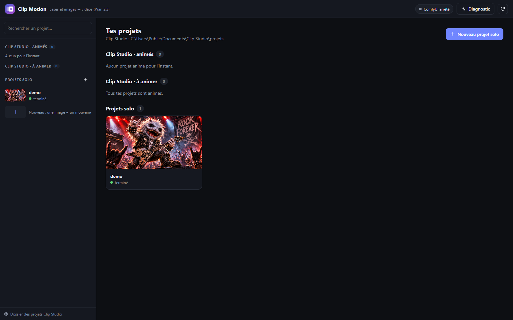
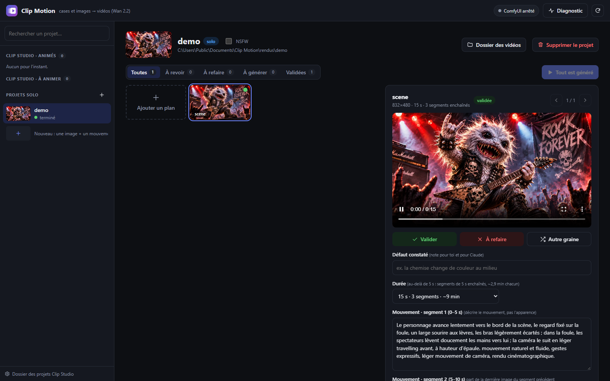

<p align="center"></p>

# Clip Motion

**Français** · [English summary](#english-summary)

[](LICENSE)
[](#prérequis)
[](#prérequis)

Clip Motion **anime des images fixes avec l'IA, en local** : une image + une phrase décrivant le mouvement donnent
une vidéo de 5 à 30 secondes. Il s'appuie sur le modèle **Wan 2.2** (image → vidéo, 14 milliards de paramètres) piloté
par **ComfyUI**, et se manie entièrement depuis une interface web locale : aucun nœud ComfyUI à brancher, aucune ligne
de commande nécessaire.

<p align="center"></p>
<p align="center"><sub>Une image fixe animée par Clip Motion (Wan 2.2, 3 segments de 5 s enchaînés).</sub></p>

Il sert aussi de **compagnon à [Clip Studio](https://github.com/BandDiLondon/Clip-Studio)** : il lit un projet de clip
musical, transforme chaque case illustrée en vidéo, puis les installe dans le projet pour que Clip Studio les monte.

> **Projet personnel**, partagé tel quel : l'aide est apportée au mieux, sans délai garanti. Testé uniquement sur
> Windows 11 avec une carte **AMD Radeon RX 9070 XT** (16 Go). Pour signaler un problème, ouvre une
> [issue](../../issues) en indiquant ta carte graphique, ta version de ComfyUI et le message d'erreur.

## English summary

Clip Motion animates still images locally with **Wan 2.2 image-to-video** (14B, GGUF) through **ComfyUI**: one image
plus a sentence describing the motion gives a 5 to 30 second video. Everything happens in a local web interface
(French only). It also works as a companion to [Clip Studio](https://github.com/BandDiLondon/Clip-Studio): it turns
every illustrated panel of a music-video project into a video clip and installs it back into the project. Tested only on
Windows 11 with an AMD Radeon RX 9070 XT (16 GB, ROCm); the post-processing step uses the AMD hardware encoder
(`h264_amf`). Installation steps are below (model links and target folders are language-independent).

## Fonctionnalités

- **Projets solo** : glisse, colle (Ctrl+V) ou choisis une image, décris le mouvement, c'est tout. Le format (paysage
  832×480, portrait 480×832 ou carré 624×624) est détecté tout seul.
- **De 5 à 30 secondes** : au-delà de 5 s, la vidéo est faite de segments de 5 s enchaînés (la dernière image d'un
  segment sert de départ au suivant), chacun avec son propre mouvement, puis assemblés.
- **Revue des vidéos** : mosaïque (survol = lecture), grande vidéo, boutons Valider / À refaire / Autre graine,
  note sur le défaut constaté, raccourcis clavier (`O`, `R`, `G`, `←` `→`). « Générer » ne refait que ce qui est
  manquant, à refaire ou modifié ; l'ancienne version est archivée, jamais perdue.
- **Projets Clip Studio** : préparation des cases (prompt de mouvement tiré de la description de chaque case),
  génération, post-traitement, installation dans le projet par **liens physiques** (aucun doublon sur le disque),
  rendu Clip Studio lancé et suivi depuis l'interface.
- **Post-traitement** : passage de 16 à 30 images/s par interpolation et agrandissement (grand côté 1920 px).
- **Garde-fous mesurés** : avertissements sur les prompts à risque (lueur au visage, changement de tenue, texte
  à l'écran…) avec correction automatique quand le remède est connu ; vidéo grise détectée (décrochage de la carte)
  et refaite automatiquement ; nudité exclue par défaut (option par projet, mineurs toujours exclus).
- **Claude, en option** ([Claude Code](https://claude.com/claude-code)), seulement quand tu cliques :
  « Aide au prompt » (une idée en langage courant → durée, segments et exclusions) et « Corriger avec Claude »
  (réécrit le prompt d'après le défaut noté). Appel « nu », sans outils ni réglages : ~1 500 tokens au lieu de ~34 500.
- **Suivi en direct** : une tâche à la fois, avec phase, pourcentage, temps restant, journal et bouton Arrêter
  (arrêt propre) ; chaque vidéo finie apparaît aussitôt.

## Captures





## Prérequis

| | Testé | Remarques |
|---|---|---|
| Système | Windows 11 | Windows 10 devrait convenir (non testé). Pas de Linux ni de macOS pour l'instant. |
| Carte graphique | AMD Radeon RX 9070 XT, 16 Go | **16 Go de mémoire vidéo conseillés.** Une carte NVIDIA devrait faire tourner ComfyUI, mais le post-traitement utilise l'encodeur matériel AMD `h264_amf` : il faudrait l'adapter (non testé). |
| Mémoire vive | 32 Go | Le modèle déborde en mémoire vive pendant le chargement. |
| Disque | ~40 Go libres | ComfyUI portable (~8 Go) + modèles (~29 Go) + tes vidéos. |
| ffmpeg | 8.0 | Dans le `PATH` (avec `ffprobe`), compilé avec `h264_amf`. |
| Optionnel | Claude Code | Pour « Aide au prompt » et « Corriger avec Claude » (abonnement Claude Pro/Max). |
| Optionnel | [Clip Studio](https://github.com/BandDiLondon/Clip-Studio) | Pour animer les cases d'un clip musical. |

## Installation

Clip Motion n'a besoin d'aucune bibliothèque Python : il tourne avec le Python fourni par ComfyUI portable.
L'arborescence attendue est la suivante :

```
Clip Motion\
├── Clip Motion.bat
├── outils\
└── comfyui\
    └── ComfyUI_windows_portable\      ← ComfyUI portable décompressé ici
```

### 1. Clip Motion
Télécharge ce dépôt (**Code → Download ZIP**, puis décompresse) ou `git clone`, dans le dossier de ton choix.

### 2. ComfyUI portable pour AMD
Télécharge `ComfyUI_windows_portable_amd.7z` depuis les
[versions de ComfyUI](https://github.com/comfyanonymous/ComfyUI/releases) (testé avec **v0.44.0**, ROCm 7.2.1,
PyTorch 2.9.1) et décompresse-le dans un sous-dossier `comfyui\` de Clip Motion (7-Zip, ou l'Explorateur de
Windows 11). Tu dois obtenir `comfyui\ComfyUI_windows_portable\python_embeded\python.exe`.

### 3. Nœud ComfyUI-GGUF
Le modèle est au format GGUF (compressé pour tenir en 16 Go). Dans PowerShell, depuis le dossier
`comfyui\ComfyUI_windows_portable` :

```powershell
git clone https://github.com/city96/ComfyUI-GGUF ComfyUI\custom_nodes\ComfyUI-GGUF
.\python_embeded\python.exe -m pip install gguf
```

(Sans git : télécharge le zip de [ComfyUI-GGUF](https://github.com/city96/ComfyUI-GGUF) et décompresse-le dans
`ComfyUI\custom_nodes\ComfyUI-GGUF`.)

### 4. Modèles (~29 Go)
Chaque fichier va dans le dossier indiqué, sous `comfyui\ComfyUI_windows_portable\ComfyUI\models\` :

| Fichier | Dossier | Taille | Source |
|---|---|---|---|
| `Wan2.2-I2V-A14B-HighNoise-Q4_K_M.gguf` | `unet\` | 9,7 Go | [QuantStack](https://huggingface.co/QuantStack/Wan2.2-I2V-A14B-GGUF/tree/main/HighNoise) |
| `Wan2.2-I2V-A14B-LowNoise-Q4_K_M.gguf` | `unet\` | 9,7 Go | [QuantStack](https://huggingface.co/QuantStack/Wan2.2-I2V-A14B-GGUF/tree/main/LowNoise) |
| `wan2.2_i2v_lightx2v_4steps_lora_v1_high_noise.safetensors` | `loras\` | 1,2 Go | [Comfy-Org](https://huggingface.co/Comfy-Org/Wan_2.2_ComfyUI_Repackaged/tree/main/split_files/loras) |
| `wan2.2_i2v_lightx2v_4steps_lora_v1_low_noise.safetensors` | `loras\` | 1,2 Go | [Comfy-Org](https://huggingface.co/Comfy-Org/Wan_2.2_ComfyUI_Repackaged/tree/main/split_files/loras) |
| `umt5_xxl_fp8_e4m3fn_scaled.safetensors` | `text_encoders\` | 6,7 Go | [Comfy-Org](https://huggingface.co/Comfy-Org/Wan_2.1_ComfyUI_repackaged/tree/main/split_files/text_encoders) |
| `wan_2.1_vae.safetensors` | `vae\` | 0,25 Go | [Comfy-Org](https://huggingface.co/Comfy-Org/Wan_2.1_ComfyUI_repackaged/tree/main/split_files/vae) |

Les noms doivent être exactement ceux-ci : Clip Motion les appelle par leur nom.

### 5. Lancer
Double-clique sur **`Clip Motion.bat`** : l'interface s'ouvre dans ton navigateur (http://127.0.0.1:8189, locale
seulement). Laisse la fenêtre noire ouverte : la fermer arrête l'interface et la tâche en cours. ComfyUI est démarré
et arrêté tout seul quand il faut générer.

## Utilisation

### Projet solo
1. **Nouveau projet solo** (barre latérale), donne-lui un nom.
2. **Ajouter un plan** : dépose une image, choisis la durée, décris le **mouvement** (pas l'apparence : l'image la
   fixe déjà). « Aide au prompt » peut l'écrire pour toi à partir d'une idée.
3. **Ajouter et générer**, puis revois la vidéo : Valider, À refaire (avec une note), ou Autre graine.
4. La vidéo finale (30 images/s, 1920 px) se télécharge depuis la revue ou le **Dossier des vidéos**.

### Projet Clip Studio
Indique une fois le dossier des projets Clip Studio (bas de la barre latérale), choisis un projet « à animer », puis
**Tout animer** : préparation → génération → post-traitement → installation dans le projet. Après la revue,
« Générer » ne refait que ce qui a changé. L'onglet « Rendu Clip Studio » lance l'aperçu ou le rendu final.

### Écrire un bon prompt (mesuré)
- Décris le **mouvement** : gestes, déplacements, caméra. Une seule action simple par tranche de 5 s.
- Pour un plan de décor sans personnage, précise « aucun personnage ajouté ».
- Une action compliquée (lever *puis* abattre) prend deux segments.

### Ligne de commande (facultatif)
Depuis PowerShell, dans le dossier de Clip Motion (**guillemets obligatoires**, sinon Windows lance `clip.exe`) :

```powershell
& ".\Clip Motion.bat" -h                       # aide complète
& ".\Clip Motion.bat" ajouter monprojet image.png --prompt "Il tourne la tête vers la caméra" --duree 10
& ".\Clip Motion.bat" maj monprojet            # génère ce qui manque ou a changé, puis post-traitement
& ".\Clip Motion.bat" diag                     # vitesse récente et débordement de mémoire vidéo
```

## Performances

Mesurées sur RX 9070 XT (16 Go), Windows 11, ComfyUI v0.44.0 :

- **~2,8 min par tranche de 5 s** (81 images, 4 étapes, ~28 s par étape) ; ~1,5 min de plus au premier rendu.
- Si c'est **2 à 3 fois plus lent**, la mémoire vidéo déborde : ferme les applications qui utilisent la carte
  (Steam, Discord, navigateurs avec de la vidéo…) ; le bouton **Diagnostic** le confirme.
- Toujours 81 images par segment : moins d'images est *plus lent* (ComfyUI sous-estime alors sa marge).

## Tests

```powershell
comfyui\ComfyUI_windows_portable\python_embeded\python.exe -s outils\test_clipmotion.py
```

10 tests, ~5 s, sans carte graphique ni Claude (logique, interface web sur un serveur de test, syntaxe JavaScript si
Node.js est installé).

## Désinstallation

1. Pour chaque projet Clip Studio animé : `& ".\Clip Motion.bat" retirer <nom>` (retire seulement les vidéos
   installées par Clip Motion ; Clip Studio repasse aux images).
2. Supprime le dossier de Clip Motion. Rien n'est installé dans Windows (pas de registre, pas de `PATH`).
3. Caches éventuels créés par ComfyUI / ROCm, à vérifier : `%USERPROFILE%\.cache\torch`, `%USERPROFILE%\.miopen`.

## Licences

- **Clip Motion** : [GNU GPL v3](LICENSE).
- **ComfyUI** : GPL-3.0 · **ComfyUI-GGUF** : Apache-2.0.
- **Wan 2.2**, ses versions GGUF (QuantStack), le LoRA lightx2v, l'encodeur umt5 et le VAE : Apache-2.0.

Les vidéos que tu génères t'appartiennent ; vérifie les règles de la plateforme où tu les publies (YouTube demande par
exemple d'indiquer le contenu « modifié ou synthétique »).
